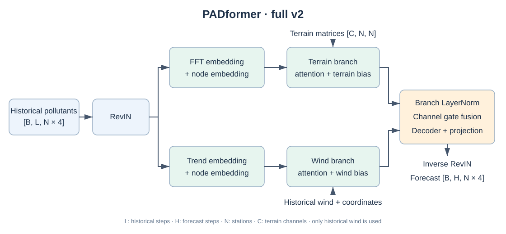

# PADformer

PyTorch implementation of PADformer for joint forecasting of PM2.5, PM10, O3 and NO2 at multiple monitoring stations. The model combines frequency/trend embeddings, terrain and historical-wind attention biases, branch fusion, and a prediction decoder.

本仓库用于 PADformer 的训练、测试、消融实验和独立预测。污染物顺序固定为 PM2.5、PM10、O3、NO2；风场输入只使用历史窗口。当前代码包不包含真实观测、训练权重或论文实验结果。

## Framework



输入经 RevIN 标准化后拆分为频域特征和移动平均趋势特征。频域分支加入地形注意力偏置，趋势分支加入由历史风场和站点坐标计算的动态偏置。融合后经解码器和输出投影生成多步预测，最后执行逆标准化。图示对应 `none_v2`；`none` 使用不同的融合方式，详见下文。

## Requirements

建议使用 Python 3.10 或更新版本，并安装与硬件匹配的 PyTorch。CPU 可运行；CUDA 为可选加速方式。依赖列表不锁定未经验证的版本组合。

```bash
python -m venv .venv
# Windows PowerShell: .\.venv\Scripts\Activate.ps1
# Linux/macOS: source .venv/bin/activate
python -m pip install -r requirements.txt
```

## Dataset

请准备自己的数据，并确保所有文件的站点顺序一致。输入格式详见 [data/README.md](data/README.md)。本项目没有自动下载真实数据的步骤。

| 文件 | 内容 |
| --- | --- |
| `data/air_quality.csv` | 四种污染物和两个风速分量 |
| `data/stations.xlsx` | 每个站点的纬度、经度 |
| `data/terrain.npz` | 五个站点间地形矩阵，单个形状为 `[N,N]` |

用于检查流程的合成数据可以通过以下命令生成：

```bash
python examples/generate_demo_data.py --output data --num_nodes 2 --steps 730
```

这些数据仅用于验证格式、训练和预测流程，不能用于论文性能比较。生成器遇到已有输入文件时会拒绝覆盖。

## Folder structure

```text
PADFormer_Code_Only/
├── README.md
├── requirements.txt
├── main.py                    # 训练、验证、测试、消融、多种子汇总
├── predict.py                 # 使用已训练权重预测最新历史窗口
├── model.py                   # PADformer 主模型
├── Embedding.py               # FFT/趋势嵌入、移动平均
├── Physics_block.py           # 地形和风场偏置、注意力编码
├── Decoder.py                 # 时间、空间和交叉注意力解码
├── RevIN.py                   # 可逆实例标准化
├── data_preprocess.py         # 滑动窗口、Dataset
├── utils.py                   # 指标、随机种子、日志
├── data/README.md             # 输入数据约定
├── examples/generate_demo_data.py
├── Fig/PADformer.svg
├── docs/REPOSITORY_MAPPING.md  # 与参考仓库的内容对应
└── results/                   # 运行后生成；不随源码分发
```

## Train and test

从本目录执行。下面是合成数据上的单轮流程检查：

```bash
python main.py --num_nodes 2 --csv_path data/air_quality.csv --station_path data/stations.xlsx --terrain_path data/terrain.npz --ablation none_v2 --seeds 50 --num_workers 0 --epochs 1 --batch_size 64 --run_tag demo
```

真实数据训练时，将站点数和文件路径替换为实际值，移除 `--epochs 1`，使用适合实验的批大小和训练轮数。数据以时间步顺序按 60%/20%/20% 划分训练、验证和测试集，然后在各段内单独生成滑动窗口，窗口不跨分界。每一段至少需要 `lag + pre_len` 个时间步。验证集用于选择最佳权重，测试集用于最后评估。

默认训练使用 MAE 损失和 Adam。训练入口会保存最佳验证损失对应的 `best_model.pth`，结束后加载该权重进行测试。默认模型变体是 `none`；需要分支归一化和逐通道融合门时，应显式指定 `--ablation none_v2`。

## Predict

预测使用训练生成的 JSON 配置与该次运行的权重文件，模型变体必须与训练一致。示例路径对应上面的合成数据命令：

```bash
python predict.py --config results/Experiment_Config_demo.json --checkpoint results/custom_dataset_demo_none_v2_seed50/best_model.pth --ablation none_v2 --csv_path data/air_quality.csv --station_path data/stations.xlsx --terrain_path data/terrain.npz --output predictions/latest.csv
```

预测入口取每个站点最后 `lag` 步历史数据，输出各站点未来 `pre_len` 步的四种污染物预测。站点集合、顺序和静态地理输入须与训练一致，权重中包含训练时的地形与地理缓冲区；此入口不支持直接迁移到新的站点网络。输出列为 `station_index`（从 0 开始）、`forecast_step`（从 1 开始）和四种污染物。步长单位由输入采样间隔决定；小时解释要求输入为逐小时数据。此入口不进行测试集评估，也不自动生成未来时间戳。使用 `--device cuda:0` 可选择 GPU。

## Arguments

完整参数以 `python main.py --help` 为准。

| 参数 | 默认值 | 说明 |
| --- | --- | --- |
| `--num_nodes` | 必填 | 站点数 |
| `--var_dim` | 4 | 当前读入的污染物列固定为四列，请保持 4 |
| `--lag` / `--pre_len` | 72 / 72 | 历史与预测窗口长度 |
| `--csv_layout` | station_block | 也支持 time_block |
| `--terrain_channels` | 3 | 3 或 5 个地形通道 |
| `--batch_size` | 32 | 批大小 |
| `--learning_rate` | 0.0005 | 学习率 |
| `--epochs` | 1000 | 最大轮数 |
| `--early_stop_patience` | 30 | 早停耐心轮数 |
| `--min_delta` | 0.005 | 重置早停计数的最小改善幅度 |
| `--num_layer` / `--muti_head` | 1 / 2 | 编码循环次数、注意力头参数（保留现有参数拼写） |
| `--dropout` | 0 | Dropout |
| `--seeds` | 50 | 支持多个种子 |
| `--num_workers` | 4 | Windows 流程检查推荐 0 |
| `--strict_deterministic` | True | 严格确定性设置 |
| `--gpu_id` | 0 | CUDA 设备编号；无 CUDA 时使用 CPU |
| `--result_root` | ./results | 输出目录 |
| `--run_tag` | 自动构造 | 实验标识；复用标识会复用输出位置 |

当前训练测试指标固定访问 24、48、72 步，因此训练入口要求 `pre_len >= 72`。内置特征宽度为 144，并未提供 `--d_model` 参数。MSTVFFN 的 Chebyshev 阶数、图卷积隐层宽度等参数不适用于本模型。

## Ablation experiments

| 选项 | 实际行为 |
| --- | --- |
| `none` | 完整物理双分支、逐位置标量融合门 |
| `none_v2` | 完整物理双分支、分支 LayerNorm、逐通道融合门 |
| `no_all` | 原始共享嵌入、无物理偏置、固定均值融合 |
| `no_freq_time_embed_v2` | 保留 v2 结构，改为原始共享嵌入 |
| `no_terrain_physics` | 保留 v2 分支，仅关闭地形注意力偏置 |
| `no_wind_physics` | 保留 v2 分支，仅关闭风场注意力偏置 |
| `no_arbitration_v2` | 保留分支归一化，改为固定均值融合 |

例如执行完整 v2 与五个消融条件：


`RevIN` 表示可逆实例标准化，相关原始研究为 Kim et al., *Reversible Instance Normalization for Accurate Time-Series Forecasting against Distribution Shift*, ICLR 2022。模型或类的重命名不改变所借用模块的来源。当前文件没有足够信息确认每个模块的具体代码来源和许可范围，公开发布前应由作者核实并补齐第三方许可声明。

PADformer 的正式论文题目、作者、DOI 和代码许可尚未在此代码包中确认，因此本 README 不填写虚构引用，也不替作者授予代码使用许可。
